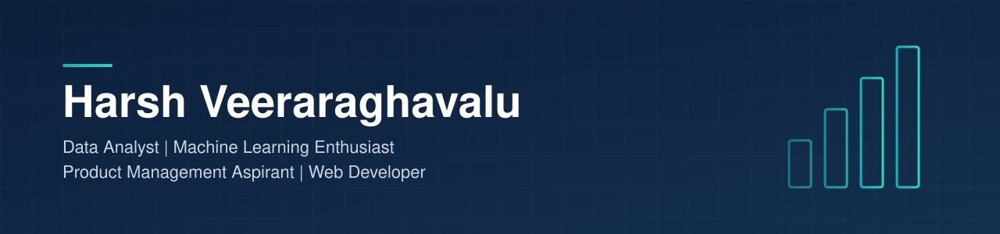
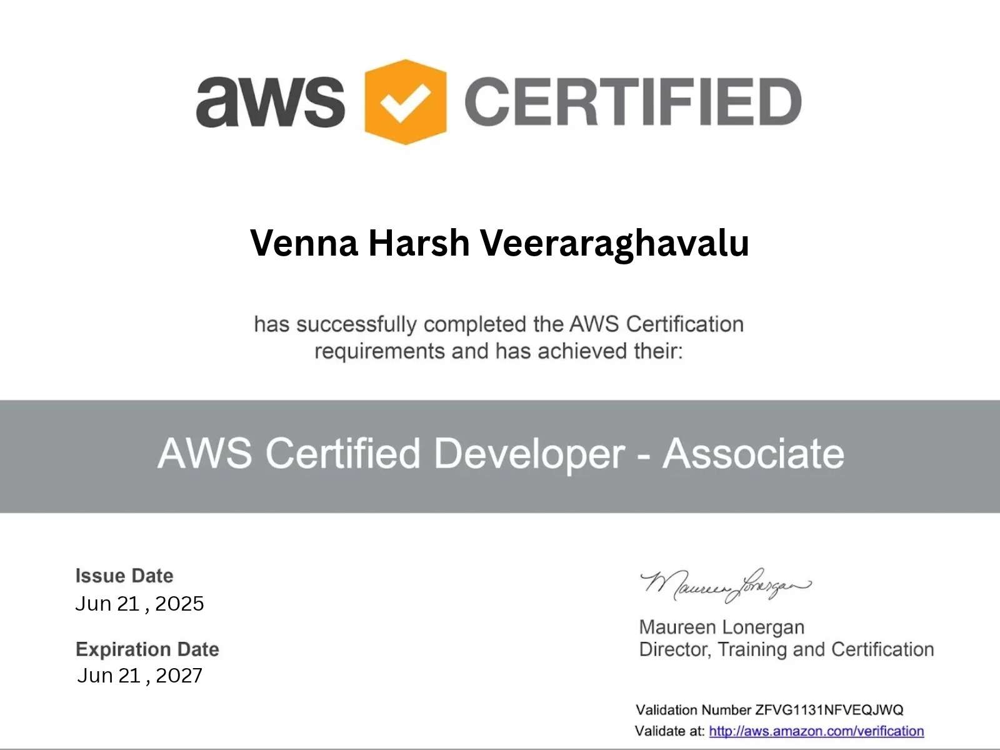

 

<a href="https://www.linkedin.com/in/harsh-venna-a7a7a53a/">LinkedIn</a> &nbsp;·&nbsp;
<a href="https://github.com/harshvenna?tab=repositories">Repositories</a> &nbsp;·&nbsp;
<a href="certifications/README.md">Certifications</a>

## About

B.Sc. Computer Science graduate focused on turning data into decisions. My interests sit across data analytics, business intelligence, Python development, machine learning, deep learning, SQL, web development, data engineering and product management.

## Technical Expertise

| Area | Focus |
| --- | --- |
| Data Analytics and BI | Data analysis, dashboards, business intelligence |
| Programming | Python, R, JavaScript |
| Machine Learning | Machine learning, deep learning |
| Databases | SQL |
| Web Development | HTML, CSS, JavaScript |
| Cloud | AWS (certified developer) |
| Product | Product management (aspiring) |

### Technology Stack

<!-- Edit the list in the URL to match the tools you actually use. See docs/CUSTOMIZATION.md -->

  

## GitHub Statistics

<!-- Third-party services. If a card fails to load, see docs/TROUBLESHOOTING.md -->

  <picture>
    <source media="(prefers-color-scheme: dark)" srcset="https://github-readme-stats.vercel.app/api?username=harshvenna&show_icons=true&hide_border=true&bg_color=0B1F3A&title_color=2DD4BF&icon_color=2DD4BF&text_color=E2E8F0">
    
  </picture>
  <picture>
    <source media="(prefers-color-scheme: dark)" srcset="https://github-readme-stats.vercel.app/api/top-langs/?username=harshvenna&layout=compact&hide_border=true&bg_color=0B1F3A&title_color=2DD4BF&text_color=E2E8F0">
    
  </picture>

  <picture>
    <source media="(prefers-color-scheme: dark)" srcset="https://streak-stats.demolab.com?user=harshvenna&hide_border=true&background=0B1F3A&ring=2DD4BF&fire=2DD4BF&currStreakNum=FFFFFF&sideNums=FFFFFF&currStreakLabel=2DD4BF&sideLabels=E2E8F0&dates=94A3B8">
    
  </picture>

### Contribution Activity

  <picture>
    <source media="(prefers-color-scheme: dark)" srcset="https://github-readme-activity-graph.vercel.app/graph?username=harshvenna&bg_color=0B1F3A&color=E2E8F0&line=2DD4BF&point=FFFFFF&area=true&area_color=2DD4BF&hide_border=true">
    
  </picture>

### Contribution Snake

<!-- Generated by .github/workflows/snake.yml and published to the "output" branch. It will not render until the workflow has run once. -->

  <picture>
    <source media="(prefers-color-scheme: dark)" srcset="https://raw.githubusercontent.com/harshvenna/harshvenna/output/github-snake-dark.svg">
    
  </picture>

## Featured Projects

Project write-ups are added here only after each repository has been reviewed. Browse everything that is public on [GitHub](https://github.com/harshvenna?tab=repositories).

<!--
TEMPLATE ROW (fill in from the repository's real README and source code, then add a table header):

| [<repo-name>](https://github.com/harshvenna/<repo-name>) | <description> | <stack> |

Candidates to add once public and reviewed:
- Nassau-Candy-Factory-Optimization-System
- Workforce-Intelligence-Analytics-System
-->

## Certifications

<table>
  <tr>
    <td align="center" width="33%">
       
      <b>AWS Certified Developer – Associate</b> 
      Amazon Web Services 
      Issued June 21, 2025 · Expires June 21, 2027
    </td>
    <td align="center" width="33%">
       
      <b>Microsoft Certified: Data Analyst Associate</b> 
      Microsoft 
      Achieved July 17, 2025 · Valid to July 17, 2027
    </td>
    <td align="center" width="33%">
       
      <b>Introduction to Front-End Development</b> 
      Meta · Coursera 
      Completed April 1, 2026 · <a href="https://coursera.org/verify/DTKMLXSEMNUV">Verify</a>
    </td>
  </tr>
</table>

<a href="certifications/README.md">View certificate images and full details</a>

## Connect

- LinkedIn: [harsh-venna-a7a7a53a](https://www.linkedin.com/in/harsh-venna-a7a7a53a/)
- GitHub: [@harshvenna](https://github.com/harshvenna)

Certificate names, logos and badges belong to their respective issuers. Third-party widgets (GitHub Readme Stats, Streak Stats, Activity Graph, Skill Icons, Typing SVG) are external services and may be temporarily unavailable.
